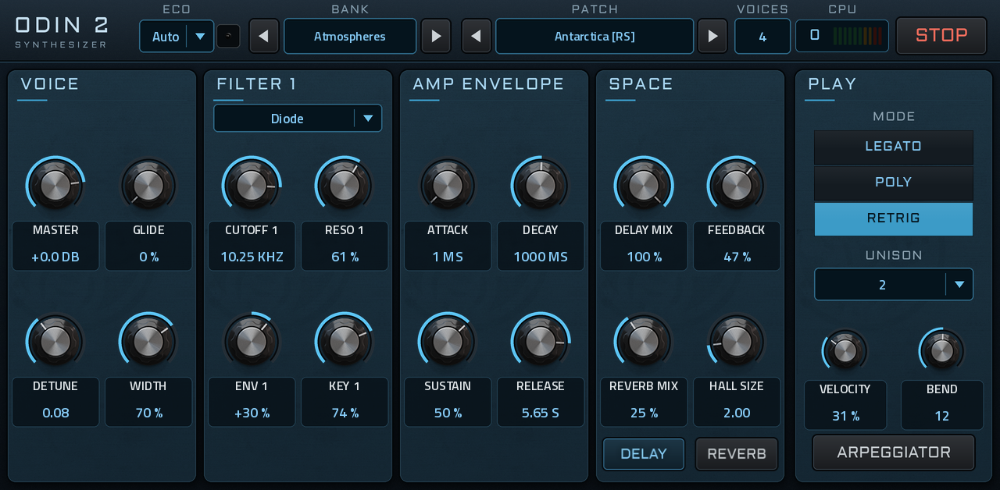
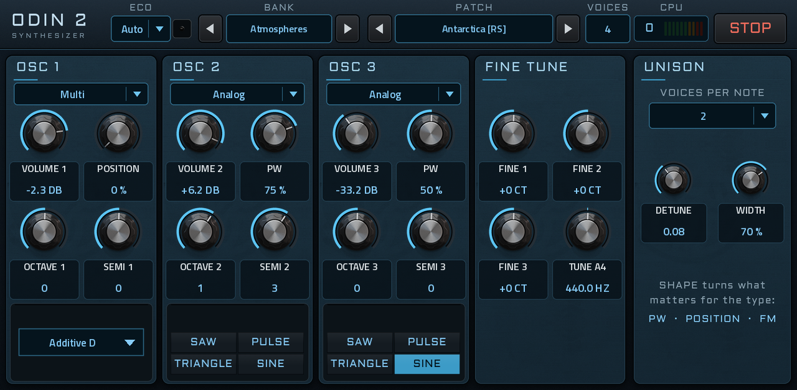
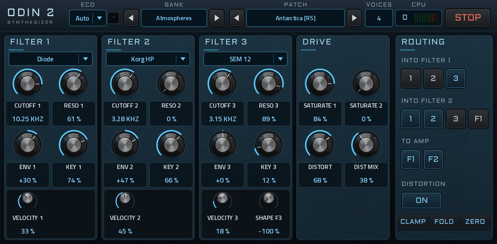
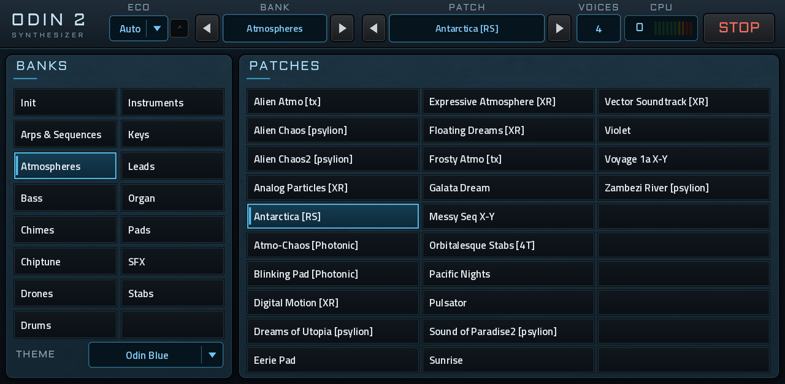
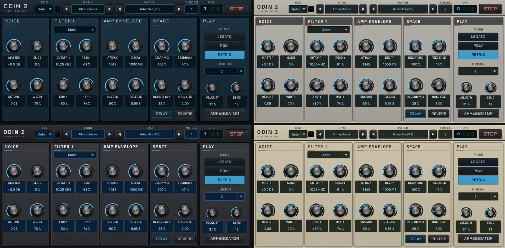

# Odin 2 for MPC



| OSC | FILTER | BROWSE |
|---|---|---|
|  |  |  |

**Four themes, switched live:** Odin Blue, 2000, 2500, 3000



[Odin 2](https://github.com/TheWaveWarden/odin2), TheWaveWarden's semi-modular synthesizer, as a native
VST2 instrument for Akai MPC OS standalone devices (built for a Gen 1 MPC Live II), with its own touchscreen pages in
Odin's look. It is built with the [mpc-vst-plugins](https://github.com/sd88me/mpc-vst-plugins) kit.

This is Odin's own sound engine (oscillators, filters, envelopes, LFOs, mod matrix, arpeggiator, effects), compiled
for the MPC's ARM processor without JUCE. Odin's 261 factory patches are built in and load exactly as Odin loads them
(checked patch by patch against Odin's own patch reader, `tools/engine_test.sh`).

## What's on the MPC

Six pages, laid out for playing standing up on a 4-knob MPC (Live II): each sound page is four columns of four big
knobs, and each column is one Q-Link column, so the four Q-Links turn exactly the four knobs outlined on screen
(press the Q-Link button to move to the next column). Every knob shows a short name (CUTOFF 1, ATTACK, DELAY MIX…)
and its value on a dark plate, the same size on every page. Choices you set and leave (types, routing, play mode)
are in the panel on the right, where MPC's Q-Link panel slides in while you turn a Q-Link.

- **Top bar (every page):** ECO and its light, **BANK ◀ name ▶** (the arrows change the bank only, the sound stays),
  **PATCH ◀ name ▶** (the patches of that bank), VOICES (how many voices the patch can sound now; Odin sets it,
  see below), the CPU meter, STOP. Patches are also in MPC's PRESET menu.
- **MAIN:** Voice (master, glide, unison detune and width), Filter 1 (cutoff, resonance, envelope, key follow, and
  its type), the amp envelope, Space (delay and reverb amounts, with their on buttons). Right: play mode, unison
  voices, velocity, bend range, arpeggiator.
- **OSC:** oscillators 1–3 (volume, SHAPE, octave, semitone; the type picker on top; the type's own choice in the
  dark window at the bottom), fine tune for all three plus **TUNE A4**, the master tune (415–465 Hz, 440 in the
  middle; it belongs to the plugin, so it stays when you change patches, and is saved with the project; new notes
  take it). **SHAPE** turns whatever matters for the oscillator's type and is named after it: PW (analog), POSITION
  (wavetable, multi), VECTOR X, FM/PM AMOUNT, LOWPASS (noise). Right: unison.
- **FILTER:** filters 1 and 2 (per voice) and 3 (on the stereo sum): cutoff, resonance, envelope, key follow, plus
  velocity and the type's own control (SEM shape, formant vowel, ring-mod amount) in the bottom window; Drive (filter
  saturation, distortion amount and mix). Right: routing and the distortion type.
- **ENV:** amp, filter and mod envelopes (A/D/S/R), the four LFO rates. Right: the LFO waves.
- **FX:** delay, reverb, chorus, phaser, each with its on button. Right: flanger.
- **BROWSE:** the banks on the left, the chosen bank's patches on the right, as big tiles: tap a bank to see its
  patches, tap a patch to load it. Bottom left: **THEME**. Q-Link 1 scrolls the banks only and Q-Link 2 the patches of that bank only, one
  step per few clicks so they don't race.

**Themes** (switch any time; saved with the project, kept when you change patches): **Odin Blue** (Odin 2's own
look, the default), and three homages to classic MPCs drawn from scratch (no Akai logos or artwork): **2000**
(warm light grey, dark label bands, red accents), **2500** (charcoal, silver edges, blue displays) and **3000** (cream
and taupe, red accents, a violin and music notes). The skin's images take about 112 MB of the MPC's memory with all
four looks (1.3: 66 MB).

Left out because they are awkward on a touchscreen or rarely touched live (the patch still has them, factory
patches set them, projects keep them): the mod matrix, the arpeggiator's step editor, drawing waveforms, vector
corner waves, FM/PM carrier and modulator waves, LFO sync, effect order, per-filter gain, amp pan and gain, the
reverb EQ and the delay's high-pass and ducking.

### CPU meter, VOICES, ECO and STOP

The MPC gives a plugin about 2.9 ms to make each block of 128 samples, shared with everything else in the project.
Odin computes every voice live, so a big patch with many notes held can run out of time and crackle. Since 1.3 Odin
looks after this itself; there is no voices knob to turn.

- **CPU** shows how much of that block time Odin uses, averaged over about a tenth of a second (so a single busy
  moment, like a chord starting, doesn't read as an overload), then held and falling slowly. Green is fine; amber
  (60–80 %) is getting busy; red is where a busy project will start to crackle. It only updates a few times a
  second, so the meter itself costs next to nothing.
- **VOICES** shows how many voices the current patch may sound at once. Odin works it out: every factory patch was
  measured (calibrated on a Live II: Antarctica [RS], 4 voices at audio rate = 80 % on the meter), and while you
  play it follows what each voice really costs, so the voices fill about three quarters of the block and no more.
  A light patch gets 16 voices, a heavy one as few as 3 or 4. Your own edits are measured the same way.
  - Notes held count as voices, and so do notes still releasing; a unison patch uses several voices per note.
  - When a chord needs more voices than there are, a unison patch plays its chord notes with fewer unison voices
    each instead of dropping notes (ECO Auto, Eco and Lite); past that, the oldest note gives way, as on any synth.
  - If the load still climbs toward the limit (an edit that makes the patch heavier, a busy project), the oldest
    note fades out in 15 ms before anything crackles, and VOICES drops. It comes back up by itself once the load
    is low again.
- **ECO** chooses how much Odin may simplify to fit more voices:

  | Setting | What it does |
  |---|---|
  | **Off** | each voice exactly as Odin plays it (still within the voice budget) |
  | **Auto** (default) | modulation, oscillator pitch and filter cutoff worked out every 8 samples instead of every sample (5.5 kHz, about a quarter less work, as good as inaudible); envelopes, LFOs, FM/PM and the audio itself stay per sample. If Odin's load still climbs past the voice budget (about 85 %), new notes also start with at most 3 unison voices (2 above about 95 %, 1 if Odin runs out of time altogether), back to the full patch after 1.5 s of low load. Notes already playing are never changed |
  | **Eco** | modulation every 16 samples (about a third less work) and at most 3 unison voices per note: very close to the original, about half the CPU on the heaviest patches |
  | **Lite** | as Eco, at most 2 unison voices, and the per-voice distortion without oversampling: slightly harsher distortion on high notes |

  A patch that modulates from an oscillator or filter output (audio-rate modulation in the mod matrix) always runs
  per sample. The light next to ECO is on while ECO is cutting unison or the distortion's oversampling. ECO is saved
  with the project and stays as you set it when you change patches.
- **STOP** silences everything at once: every voice, held notes, the arpeggiator, and the delay and reverb tails.

## Build (Ubuntu, Docker)

Put this folder next to your `mpc-vst-plugins` checkout, in the same Ubuntu folder you build the other ports from:

```
~/mpc-vst-plugins
~/odin2-mpc
```

Then:

```
cd ~/odin2-mpc
./build.sh
```

The first run downloads Debian bullseye and its ARM cross compiler into Docker once (a few minutes). After that a
full build takes a few minutes on a typical PC and a small change seconds: the plugin is compiled natively on every
core with the cross compiler (`tools/cross/Dockerfile`, `tools/arm.mk`; the same glibc 2.31 as the kit's own image,
so the plugin loads on MPC OS 2.x and 3.x), only what changed is recompiled, and the skin is rebuilt only when the
pages or their artwork changed (in the kit's `mpc-vst-html-art` container). The result is packaged with the kit's
`tools/release.py` as `dist/Odin-2-1.4.1-mpc-armv7.zip`.

`SLOW=1 ./build.sh` builds the kit's way instead (`tools/build_port.sh`: the compiler under ARM emulation, 30-60
minutes). If `mpc-vst-plugins` is somewhere else, run `MPC_VST=/path/to/mpc-vst-plugins ./build.sh`. If Docker
says "exec format error" (only the SLOW build and the kit's screenshot tool emulate ARM), run
`docker run --privileged --rm tonistiigi/binfmt --install arm` once.

## Install on the MPC

The zip has an installer that stops MPC, backs up `MPC.settings`, installs the plugin folder into `/sdcard/Synths`,
registers it and starts MPC again. **Save your project first.** From Ubuntu, with the MPC's IP address:

```
cd ~/odin2-mpc/dist
unzip Odin-2-1.4.1-mpc-armv7.zip
scp -r Odin-2-1.4.1 root@<mpc-ip>:/tmp/
ssh root@<mpc-ip> sh /tmp/Odin-2-1.4.1/install.sh
```

`INSTALL.md` in the zip has the same steps and the manual ones (copy the folder, edit `MPC.settings` yourself with
MPC stopped). The plugin shows up as **Odin 2** (manufacturer 3dthc) in MPC's plugin browser.
`ssh root@<mpc-ip> sh /tmp/Odin-2-1.4.1/uninstall.sh` removes it again.

## First test on the device

1. Insert Odin 2 on a track and play a few notes (the Init patch).
2. Step banks and patches with the top bar's arrows, on BROWSE, and from the PRESET menu; switch THEME on BROWSE.
3. Hold a big chord on a heavy patch (Antarctica [RS], Alien Chaos2): VOICES shows what it allows, CPU stays out
   of the red, and it plays without crackling.
4. Press STOP while a long reverb/delay tail is ringing.
5. On OSC, turn TUNE A4 away from 440 Hz and play: the pitch follows; change patch, it stays.
6. Turn every page and the Q-Links; change an oscillator and a filter type and check the panel follows.
7. Save the project, reload it, and check the patch, your edits and the tune came back.

## Folder

| Path | What |
|---|---|
| `build.sh` | build and package (above) |
| `vst/vst.json` | the port's build description for mpc-vst-plugins |
| `vst/make_params.py` → `vst/params.json`, `src/odin_mpc_params.inc` | the controls the MPC sees and the Odin state each drives |
| `vst/make_skin.py` → `vst/layout.conf`, `vst/art/gen/` | the pages in the four looks (Odin's artwork in `vst/art/odin/`) |
| `vst/skin_post.py` | a touch-up to the built skin: the Q-Link column outline below the larger value text |
| `tools/device_preview.py`, `tools/dump_values.cpp` | previews of the built pages with a patch's real values and live text (dev) |
| `src/odin_mpc.cpp` | the engine the kit's VST2 wrapper drives: controls, patches, project state, voice budget, ECO, STOP, CPU meter |
| `src/odin_state.h` | a patch as text lines (the bank and the project state store differences) |
| `src/presets/` | the factory bank, generated by `tools/make_bank.sh` from `presets_src/`, and each patch's measured load (`bank_cost.inc`, generated by `tools/patch_cost.sh`) |
| `src/odin/` | Odin 2's engine, vendored; what changed is in `src/VENDORED.md` |
| `tools/engine_test.sh` | offline engine test (bank vs Odin's loader, state round trip, STOP, ECO, voice budget, timings) |
| `tools/patch_cost.sh` | measures every factory patch's load and writes `src/presets/bank_cost.inc` |

Regenerate after editing: `python3 vst/make_params.py` (parameter list), `python3 vst/make_skin.py` (pages, needs
Pillow), `tools/make_bank.sh` (bank, then `tools/patch_cost.sh` for its costs). Keep the parameter order: projects store values by position; add new controls
at the end of `make_params.py`.

## Licences

GPL-3.0-or-later (`LICENSE`), as Odin 2. Odin 2 and its artwork and patches are by TheWaveWarden and contributors.
The Aldrich and Titillium Web fonts are under the SIL Open Font License (`vst/art/fonts/OFL.txt`, `OFL-TitilliumWeb.txt`). Surge's tuning library is MIT.
